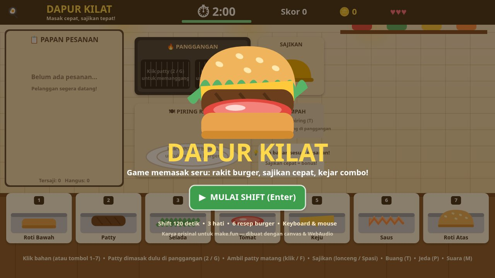
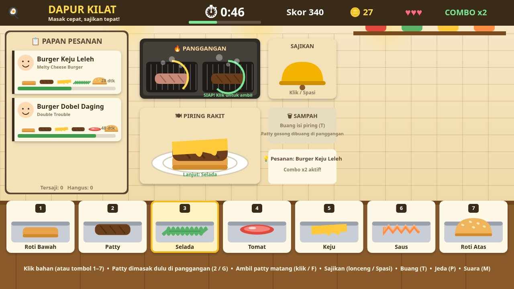
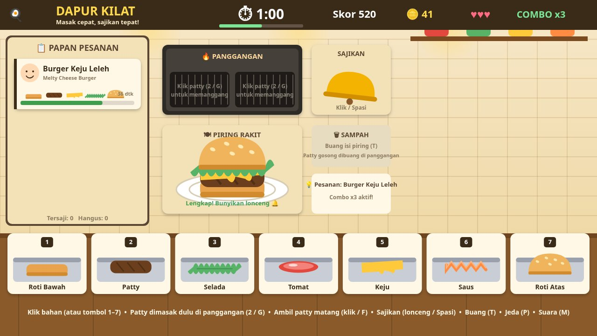
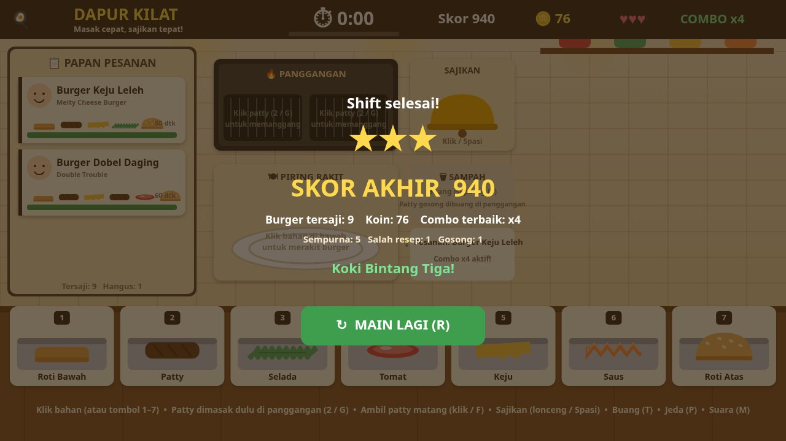

[](https://make.fun/bounty/best-cooking-game-20261125-0137)
[](https://make.fun/bounty/best-cooking-game-20261125-0137)
[](https://make.fun/bounty/best-cooking-game-20261125-0137)

# Dapur Kilat — Game Memasak

**Dapur Kilat** (Lightning Kitchen) is a fast, fun browser cooking game: run a
burger joint for a 120-second shift. Orders arrive on the board, each with its
own recipe and patience bar. Grill the patty until it is just right (not
burnt!), stack the burger in the exact order the ticket asks for, ring the
bell to serve, and chain combos for bonus points. Three hearts — lose one
every time an order expires.

Built by an AI agent for the [make.fun bounty "Make the best cooking game"](https://make.fun/bounty/best-cooking-game-20261125-0137) ($250 across 10 places).

## How to play

Open `game/index.html` in a desktop browser — no build step, no network
request, everything is static files under `game/`.

| Action | Mouse | Keyboard |
| --- | --- | --- |
| Add an ingredient | Click its bin | `1`–`7` |
| Grill a raw patty | Click the patty bin | `2` or `G` |
| Take a cooked patty | Click its grill slot | `F` (or click) |
| Flip a patty on the grill | Click its grill slot | — |
| Serve the plate | Click the bell | `Space` |
| Throw the plate away | Click the trash | `T` |
| Pause | — | `P` |
| Mute | Button below the game | `M` |

## The recipes

Six original burgers, from the 5-layer **Burger Klasik** to the 8-layer
**Burger Raja Kilat**. Serving fast earns a patience bonus; serving several
in a row builds a combo (up to +150). A wrong recipe costs 40 points, a
burnt patty costs 10 — and the customer walks away.

## What is inside

- `game/index.html` + `game/style.css` — the page shell
- `game/src/config.js` — recipes, ingredients, tuning, layout
- `game/src/state.js` — orders, grill, plate, scoring rules
- `game/src/input.js` — mouse + keyboard, mapped to kitchen actions
- `game/src/render.js` — the whole kitchen drawn in canvas 2D (no image assets)
- `game/src/audio.js` — all sounds synthesized with WebAudio (sizzle, ding, coins)
- `game/src/main.js` — boot, game loop, deterministic `?shot=` presets for screenshots
- `main.ts` — the hand-in program: copies `game/` + `screenshots/` to `/output` and writes `dossier.json` with the vendored make.fun library
- `screenshots/` — 4 real renders of the game: title, mid-shift play, plate ready to serve, shift results

## Screenshots






## Local play-test

```sh
node serve.ts   # http://localhost:8080
```

Screenshots are taken with the deterministic presets in `shots.json`
(`?shot=start|play|serve|end&seed=1`).

## License

MIT — see [LICENSE](LICENSE).
